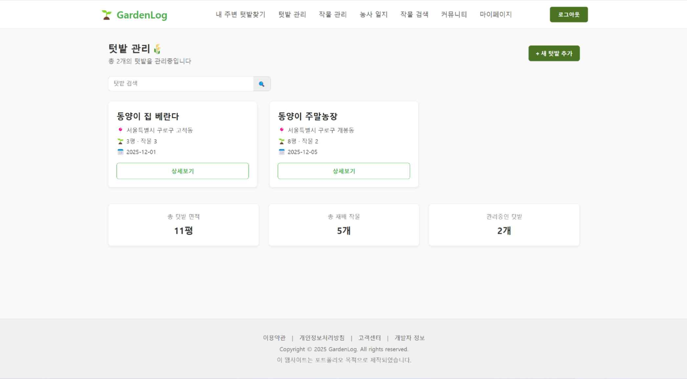
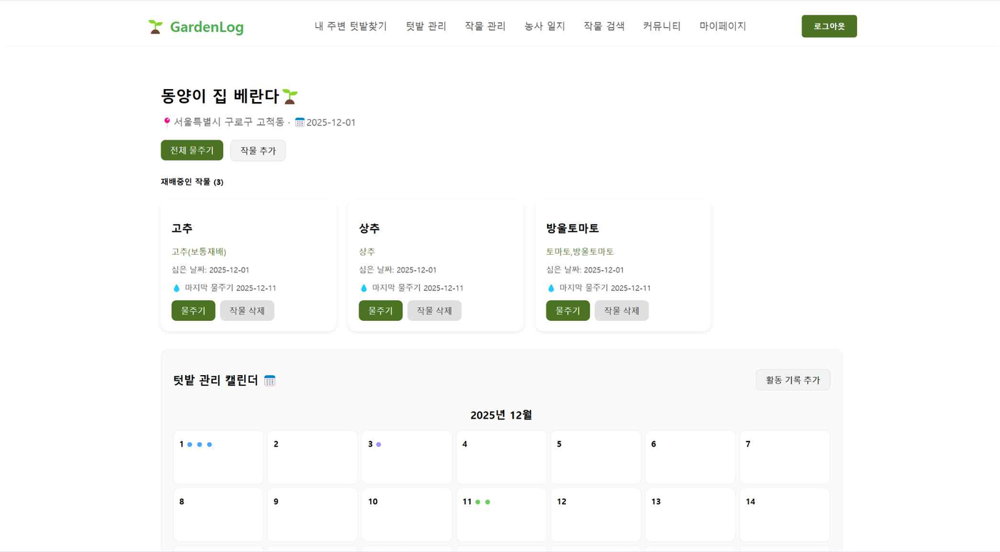
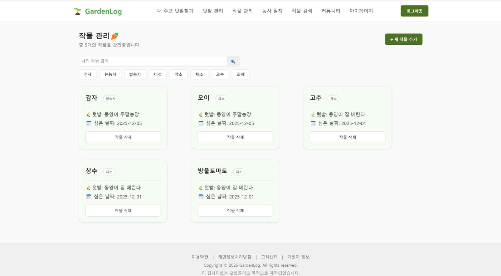
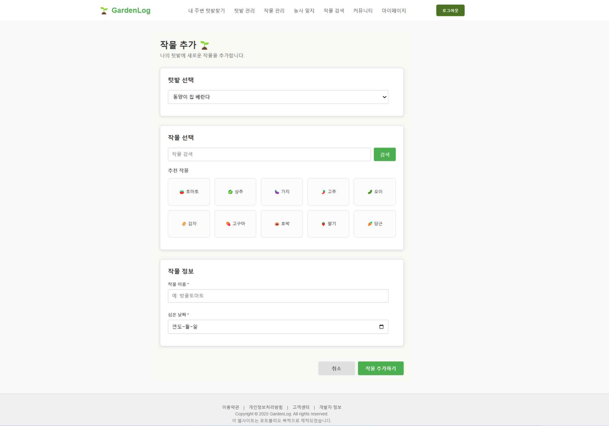
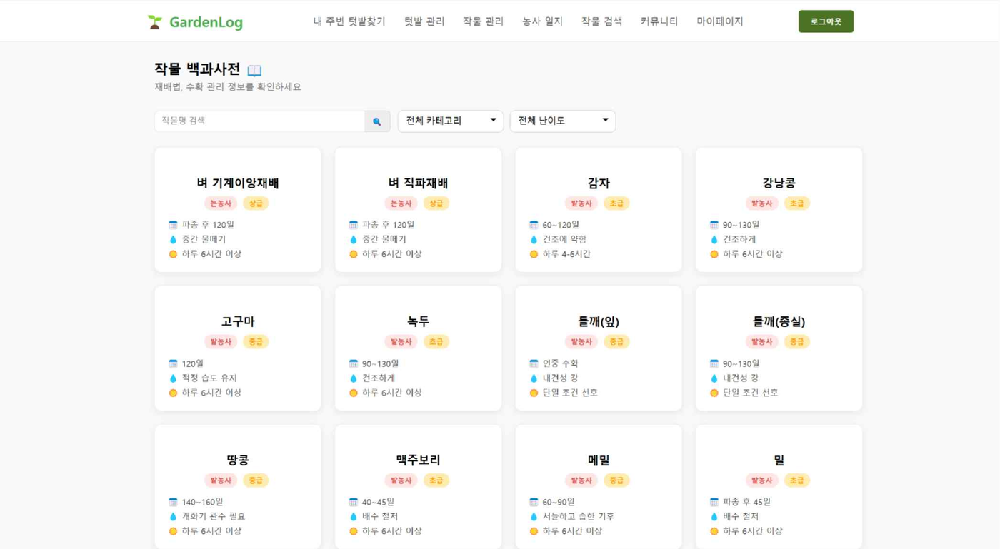
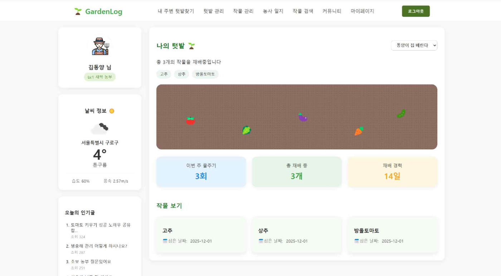

# GardenLog

도시 텃밭을 가꾸는 초보 농부를 위한 텃밭/작물 관리 웹 서비스입니다.
사용자는 자신의 텃밭과 작물을 등록하고, 물주기와 활동 기록을 캘린더로 관리하며,
농촌진흥청 농사로 데이터를 기반으로 한 작물 백과사전에서 재배 정보를 확인할 수 있습니다.

Java Servlet/JSP 기반 MVC 구조로 구현한 백엔드실습 팀 프로젝트입니다.

## 개요

| 항목 | 내용 |
| --- | --- |
| 기간 | 2025.11 - 2025.12 (약 6주) |
| 인원 | 3명 (이세연, 이나연, 조혜인) |
| 담당 | 기여도 약 45%<br>- 작물 데이터 수집 배치 (농사로 API 연동, HWPX 문서 파싱)<br>- 텃밭 관리 (등록, 검색, 상세 조회, 월별 활동 캘린더, 물주기)<br>- 작물 관리 (등록, 삭제, 카테고리 필터, 검색)<br>- 작물 백과사전 (카테고리, 재배 난이도 필터)<br>- 회원가입, 메인 페이지 텃밭 요약 |

## 기술 스택

| 분류 | 기술 |
| --- | --- |
| Language | Java |
| Backend | Jakarta Servlet, JSP, JSTL, JDBC |
| Database | MySQL |
| Server | Apache Tomcat |
| External API | 농사로 영농일정 API, 네이버 지역 검색 / Maps API, OpenWeatherMap API |
| Frontend | HTML, CSS, JavaScript |
| Tool | Eclipse, Git, GitHub |

## 주요 기능

- 회원가입 / 로그인 / 마이페이지
- 내 주변 텃밭 찾기: 사용자 위치 기준 주말농장 검색 및 지도 표시
- 텃밭 관리: 텃밭 등록, 검색, 상세 조회, 월별 활동 캘린더
- 작물 관리: 텃밭별 작물 등록, 카테고리 필터, 개별/전체 물주기
- 작물 백과사전: 약 140종 작물을 카테고리와 재배 난이도별로 조회
- 농사 일지: 작물별 일지 작성, 작성 수에 따른 사용자 등급 상승
- 관리자 페이지: 회원 조회, 정보 수정, 계정 정지

## 프로젝트 구조

MVC 패턴에 따라 Controller(Servlet), Model(DAO/DTO), View(JSP)를 분리했습니다.

```
src/main/java/com/gardenlog/servlet
├── controller   요청 분기 및 화면 이동 (Servlet)
├── dao          JDBC 기반 데이터 접근
├── dto          계층 간 데이터 전달 객체
├── api          외부 Open API 호출
├── batch        작물 데이터 수집 배치
├── filter       관리자 접근 제어
└── util         DB 연결, HWPX 파싱, JSON 변환
src/main/webapp
├── JSP          사용자 화면
├── ADMIN        관리자 화면
└── CSS
```

## 데이터베이스

| 테이블 | 설명 |
| --- | --- |
| users | 사용자 정보, 등급, 권한, 계정 상태 |
| garden | 사용자별 텃밭 (이름, 위치, 면적, 작물 수) |
| my_crop | 텃밭에 심은 작물 (별명, 파종일, 물 준 횟수, 최종 급수일) |
| garden_activity | 텃밭 활동 기록 (물주기, 비료주기 등) |
| farming_logs | 농사 일지 |
| visit_log | 출석 기록 |
| crops | 작물 품목 및 작물 코드 |
| crop_files | 작물별 영농일정 문서 정보 |
| crop_info | 작물 상세 정보 (원본 JSON, 분류, 난이도, 재배 기간, 물주기, 일조량) |

테이블 상세 정의는 [결과보고서](./docs/GardenLog%20결과보고서.pdf)에 정리되어 있습니다.

## 담당 업무

### 1. 작물 데이터 수집 배치

작물 백과사전과 작물 등록 기능에 쓰이는 작물 데이터를 농사로 Open API에서 수집해 DB에 적재했습니다.
농사로 영농일정 API는 작물 상세 정보를 HWPX(한글 문서) 파일 링크 형태로 제공하기 때문에,
파일을 내려받아 텍스트를 추출하는 단계를 별도로 구현했습니다.

```
CropImportRunner       영농일정 품목 목록 API 호출  → crops 저장
CropFileImportRunner   작물별 영농일정 문서 목록 API 호출 → crop_files 저장 (HWPX URL)
CropInfoBatchMain      HWPX 다운로드 → 압축 해제 → XML 파싱 → JSON 변환 → crop_info 저장
```

- HWPX가 ZIP 구조라는 점을 이용해 `ZipInputStream`으로 `Contents/*.xml` 본문만 추출
- 한글 문서 XML 네임스페이스를 기준으로 문단(`p`)과 표(`tbl` > `tr` > `tc`)를 순서대로 파싱
- 문서마다 구조가 달라 정형화가 어려운 텍스트는 JSON으로 묶어 `crop_info`에 저장하고, 배치를 다시 실행해도 같은 작물이 중복 저장되지 않도록 `ON DUPLICATE KEY UPDATE`로 갱신

### 2. 텃밭 관리

- 텃밭 등록, 이름 검색, 상세 조회
- 상세 화면의 월별 관리 캘린더: 해당 월의 활동 기록을 조회해 날짜별로 묶어 표시
- 활동 기록(물주기, 비료주기 등) 추가
- 전체 물주기: 텃밭의 모든 작물에 한 번에 물주기를 기록하되, 오늘 이미 물을 준 작물은 제외해 횟수가 중복으로 올라가지 않도록 처리

### 3. 작물 관리

- 작물 추가: 텃밭 선택, 작물 검색 또는 추천 작물 선택, 별명과 파종일 입력
- 작물 추가/삭제 시 해당 텃밭의 작물 수를 함께 갱신
- 카테고리 필터, 이름 검색, 총 작물 수 표시
- `my_crop`, `crop_info`, `crops`, `garden`을 조인해 작물 카드에 필요한 정보를 한 번에 조회

### 4. 작물 백과사전

- 수집한 작물 데이터를 카테고리(작물 분류)와 재배 난이도로 필터링, 이름으로 검색

### 5. 기타

- 회원가입: 아이디 중복 확인 로직을 회원가입 컨트롤러로 통합, 주소 입력 추가
- 메인 페이지 텃밭 요약: 선택한 텃밭의 물주기 횟수, 재배 작물 수, 재배 경과일을 동적으로 표시
- 로그아웃 시 세션 무효화 처리

## 화면

| 텃밭 관리 | 텃밭 상세 |
| --- | --- |
|  |  |

| 작물 관리 | 작물 추가 |
| --- | --- |
|  |  |

| 작물 백과사전 | 메인 |
| --- | --- |
|  |  |

## 트러블슈팅

### 1. 작물 상세 정보가 API 응답이 아닌 HWPX 문서로 제공되는 문제

- 문제: 농사로 영농일정 API는 작물별 재배 정보를 JSON/XML 응답이 아니라 HWPX 파일 다운로드 링크로만 제공했습니다.
- 해결: HWPX가 ZIP으로 압축된 XML 묶음이라는 점을 확인하고, 다운로드 후 본문 XML만 추출해 DOM 파서로 문단과 표 셀의 텍스트를 읽어오도록 구현했습니다. 웹 요청과 분리된 배치 프로그램으로 만들어 한 번 수집한 데이터를 DB에서 바로 조회하도록 했습니다.
- 결과: 약 140종 작물의 재배 정보를 확보해 작물 백과사전과 작물 추가 검색에 활용했습니다.

### 2. 카테고리 필터 후 전체 보기에서 작물 카드가 중복 표시되는 문제

- 문제: 작물 관리 화면에서 카테고리를 선택했다가 전체 보기로 돌아오면 작물 카드가 중복으로 표시되었습니다.
- 원인: 필터 결과 목록을 세션에 저장했는데, 전체 보기 요청에서 이를 지우지 않아 이전 필터 결과와 전체 목록이 함께 렌더링되었습니다.
- 해결: 전체 보기 요청 시 세션의 필터 결과를 제거하도록 수정했습니다. 이 경험을 통해 화면 한 번에만 필요한 데이터는 세션이 아니라 request 범위에 두어야 한다는 점을 정리했습니다.

### 3. 로그아웃 후에도 로그인 상태가 유지되는 문제

- 문제: 로그아웃 버튼이 랜딩 페이지로 이동만 해서, 뒤로 가기나 URL 직접 접근 시 로그인 상태로 서비스를 이용할 수 있었습니다.
- 해결: 로그아웃 요청을 서블릿으로 보내 `session.invalidate()`로 세션을 무효화한 뒤 리다이렉트하도록 변경했습니다.

## 실행 환경

- JDK 11 이상, Apache Tomcat 10 이상 (Jakarta Servlet)
- MySQL 8, 데이터베이스 `gardenlogdb`
- Eclipse에서 Dynamic Web Project로 import 후 Tomcat 서버에 등록해 실행
- 작물 데이터는 `batch` 패키지의 `CropImportRunner`, `CropFileImportRunner`, `CropInfoBatchMain`을 순서대로 실행해 적재

## 회고

- 프레임워크 없이 Servlet/JSP와 JDBC로 직접 구현하면서 요청 분기, 세션 관리, 커넥션 관리처럼 Spring 같은 프레임워크가 대신 처리해 주는 부분을 이해할 수 있었습니다.
- 외부 데이터가 원하는 형태로 제공되지 않을 때 원본 포맷을 분석해 수집 단계를 별도로 설계한 것이 가장 힘들면서도 기억에 남는 작업이었습니다.

## 문서

- [GardenLog 결과보고서](./docs/GardenLog%20결과보고서.pdf)
